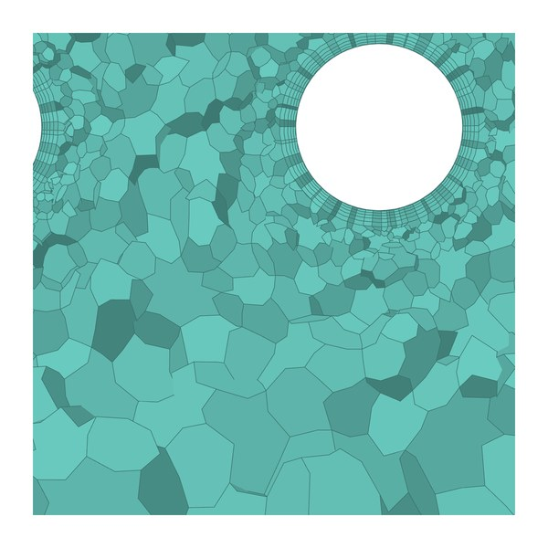
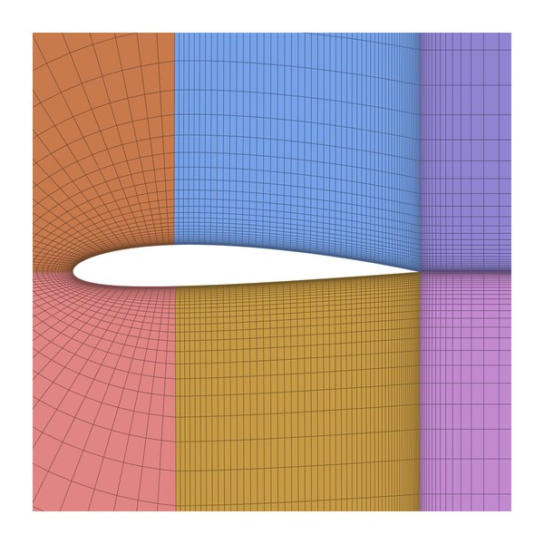
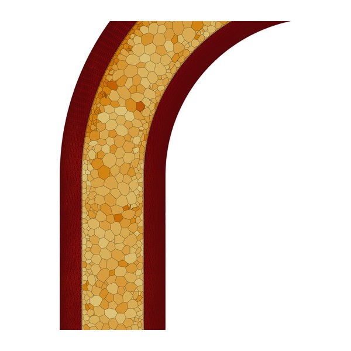
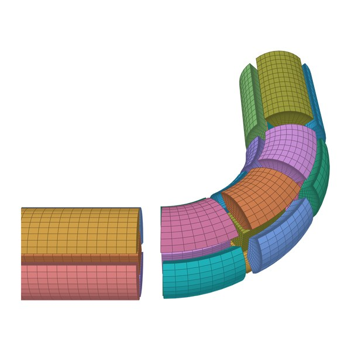
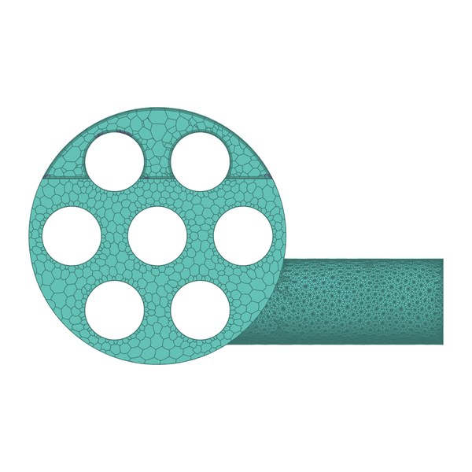
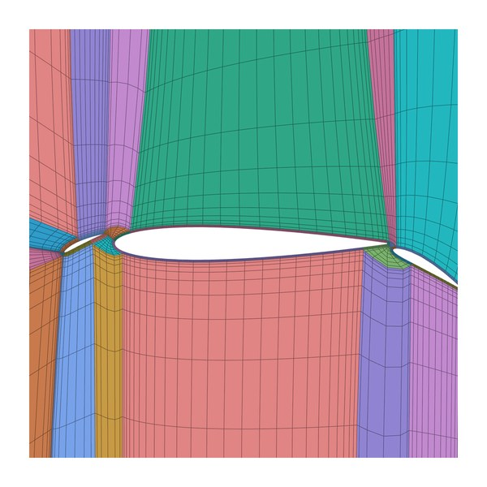

<p align="center">
  
</p>

<h1 align="center">KoflCraft</h1>

<p align="center">
  An open-source polyhedral mesh generator for CFD and multi-physics simulations, written in Rust. The companion mesher of <a href="https://github.com/chiefenne/Foehncraft">Foehncraft</a>.
</p>

<table>
  <tr>
    <td><a href="docs/applications.md#furnace-7"></a></td>
    <td><a href="docs/gallery/block.md#naca-cgrid"></a></td>
    <td><a href="docs/gallery/polyhedral.md#manifold"></a></td>
  </tr>
  <tr>
    <td><a href="docs/gallery/block.md#elbow"></a></td>
    <td><a href="docs/applications.md#heat-exchanger"></a></td>
    <td><a href="docs/gallery/block.md#multi-element"></a></td>
  </tr>
</table>

<sub>KoflCraft meshes pictured with <a href="https://github.com/chiefenne/MurmelCraft">MurmelCraft</a>, each linked to its
entry with the commands that made it: prism layers around a furnace tube; a
C-grid around a NACA 2412; the Manifold bend in non-orthogonality; an elbow
exploded into its blocks; the shell side of a heat exchanger; a three-element
airfoil. The earlier Manifold slideshow is on the
[tour page](docs/gallery/readme-tour.md); the pictures are made by
[tools/readme-hero](tools/readme-hero/make_heroes.py).</sub>

<p align="center">
  <b><a href="#install">Install</a></b> ·
  <b><a href="docs/gallery.md">Example gallery</a></b> ·
  <b><a href="docs/recipes.md">Recipes</a></b> ·
  <b><a href="docs/applications.md">Application gallery</a></b> ·
  <b><a href="docs/status.md">What works today</a></b> ·
  <b><a href="#documentation">Documentation</a></b>
</p>

---

> **Status: release 0.3.0 (tag `v0.3.0`).** Milestone M1
> is done and verified: clipped Voronoi polyhedra in a box, validated,
> exported to VTU, Gmsh, OpenFOAM and FoehnCraft, driven from a CLI and an
> MCP server. Convex STL meshing with size control (M2), nonconvex ducts with
> prism layers carried out to the ports (M3 to M5) and a block-structured
> mesher (MB1) work as prototypes, each graded with its gaps on the
> [status page](docs/status.md). New in 0.3.0: a region proposal for
> block-dominant meshing and the sweep fill, which meshes swept pipes with
> hexahedra joined conformally to polyhedra. Every example of the
> [example gallery](docs/gallery.md) and the
> [application gallery](docs/applications.md) carries the exact commands
> that made it. What changed is in
> [CHANGELOG.md](CHANGELOG.md); the milestone plan and every decision are in
> [docs/requirements.md](docs/requirements.md).

[](https://github.com/chiefenne/KoflCraft/actions/workflows/m1.yml)
[](https://github.com/chiefenne/KoflCraft/releases)
[](#install)
[](LICENSE)

## What it is for

KoflCraft makes the volume meshes that a cell-centred finite-volume solver
needs: general polyhedral cells, prism layers at walls, named boundary
patches and, later, several cell zones for conjugate heat transfer. Its first
user is [Foehncraft](https://github.com/chiefenne/Foehncraft), which reads
the meshes directly.

The guiding targets are:

- **Correct before fast.** Every mesh is checked before it is written:
  closed cells, matching interior faces, positive volumes, and conservation
  of the total volume and of every patch area. A failed check is never
  reported as success.
- **Polyhedral and layered.** Clipped Voronoi cells in the core, prism layers
  at walls that end cleanly at inlets and outlets, and conformal joins
  between them.
- **Agent-ready.** One Rust engine behind a command line and an MCP server,
  JSON in and out, every result with its evidence: input digests, algorithm,
  version, timings and validation.
- **Graphics-grade geometry.** Algorithms come first from the computer
  graphics and geometry processing community, above all the work of Keenan
  Crane (CMU), Bruno Lévy (INRIA) and Leif Kobbelt (RWTH Aachen), and are
  benchmarked before they are adopted.
- **Clean room.** Algorithms implemented from published papers and documented
  formats, MIT licensed, no copyleft code.

## What works today

- **Box meshes (M1, verified).** Clipped Voronoi cells from 16 to 256,000
  sites, clipped by their nearest sites with a completeness test, every
  cell closed, every interior face matched, volume and patch areas
  conserved; repeatable to the bit.
- **Convex STL domains (M2).** STL import and checks, size fields from
  datum objects (points, planes, boxes, spheres, cylinders, cones) and
  coordinate regions, sizes from wall curvature, gaps and feature edges,
  density-weighted CVT seeding.
- **Boundary patches.** `patch.*` tools on any closed STL (planes, boxes,
  normals, feature-angle growing, split, merge, rename, roles), port
  detection on a bare STL, patch proposals, and a FoehnCraft case skeleton
  with the type of every boundary.
- **Nonconvex ducts (M3 to M5, prototypes).** A Rust scaffold (wall remesh,
  Delaunay tetrahedra, boundary recovery), a Voronoi or median-dual
  polyhedral core, prism layers that end on the inlet and outlet planes,
  named wall patches and flush openings, walls without layers or with
  yielding layers, zero-thickness baffles and plates, polygon-prism layers,
  grading, an opt-in hex core; validity by the rules of production
  finite-volume codes. The seven-tube furnace of FoehnCraft's gallery
  builds with 222,715 cells in about 80 s
  ([application gallery](docs/applications.md)).
- **Block-structured meshes (MB1).** Templates for a channel, a pipe, an
  elbow, an airfoil C-grid and a multi-element airfoil, TFI and elliptic
  smoothing with wall orthogonality and sliding wall nodes, edit tools and
  a layout optimiser ([docs/block-mesher.md](docs/block-mesher.md)).
- **Hand-off.** `foehncraft.vtkhdf` (blocked VTKHDF, default) or
  `foehncraft.vtu`, Gmsh MSH 4.1, OpenFOAM `polyMesh`, with
  `mesh-evidence.json` and a BLAKE3 hash of every file. FoehnCraft reads
  every acceptance mesh back in CI; MurmelCraft shows them.
- **For agents.** One tool registry behind `kofl` and the MCP server (read
  and write roots), JSON in and out, journal and replay, an exact estimate
  before every build and approvals for large ones ([docs/tools.md](docs/tools.md)).

## Install

### Download a release

Ready-to-run programs are attached to each
[release](https://github.com/chiefenne/KoflCraft/releases/latest), with
`SHA256SUMS.txt` to check them:

| System | File | Then |
|---|---|---|
| macOS 11 or newer, Apple silicon and Intel | `koflcraft-<version>-macos-universal.tar.gz` | unpack, run `./kofl commands` |
| Linux x86-64 (glibc 2.28 or newer: RHEL/Rocky/Alma 8 and 9, Debian 11-13, Ubuntu 20.04 and newer; v0.2.0 needs 2.39) | `koflcraft-<version>-linux-x86_64.tar.gz` | unpack, run `./kofl commands` |
| Windows 10 or 11, x86-64 | `koflcraft-<version>-windows-x86_64.zip` | unpack, run `kofl.exe commands` |

Each one holds `kofl` (the command line; `kofl mcp` is the MCP server) and
`mesh-mcp` (the MCP server on its own). To call it by name, put the
unpacked folder on your `PATH` or copy the programs into a folder that is
on it, such as `~/.local/bin` or `~/.cargo/bin`.

The Mac programs are not signed with an Apple Developer ID, so macOS stops
them the first time ("cannot be opened" or "cannot verify the developer").
Clear the download mark once, in the unpacked folder:

```sh
xattr -dr com.apple.quarantine .
```

(or try to start it, then System Settings ▸ Privacy & Security ▸ **Open
Anyway**). Windows SmartScreen may warn the same way: **More info** ▸
**Run anyway**. To check a download: `shasum -a 256 -c SHA256SUMS.txt
--ignore-missing` (macOS), `sha256sum -c SHA256SUMS.txt --ignore-missing`
(Linux), `certutil -hashfile <file> SHA256` (Windows).

### Build from source

KoflCraft needs no system libraries, no CMake and no Gmsh; you need Rust
1.88 or newer ([rustup](https://rustup.rs); `rustup update stable` brings
an older one up to date), a C compiler and linker, and Git:

| System | Commands |
|---|---|
| macOS | `xcode-select --install`, then rustup |
| Ubuntu, Debian | `sudo apt install build-essential git curl`, then rustup |
| Fedora | `sudo dnf install gcc make git curl`, then rustup |
| Windows | Visual Studio C++ Build Tools, rustup and Git with `winget install --id ...` (the commands are in the guide) |

The rustup command on macOS and Linux is
`curl --proto '=https' --tlsv1.2 -sSf https://sh.rustup.rs | sh`.

Optional: the [Gmsh](https://gmsh.info) program on the `PATH` for the
extra check of the acceptance run (`cargo m1 --require-gmsh`):
`brew install gmsh` (macOS), `sudo apt install gmsh` (Ubuntu),
`sudo dnf install gmsh` (Fedora), the zip from gmsh.info (Windows).
KoflCraft writes `.msh` files itself and does not need Gmsh otherwise.
The step-by-step guide for each system is
[docs/install.md](docs/install.md).

Then, in a terminal:

```
git clone https://github.com/chiefenne/KoflCraft.git
cd KoflCraft
cargo build --release --locked -p mesh-cli -p mesh-mcp
target/release/kofl generate test-fixtures/box-4.json box.mesh.json
target/release/kofl check box.mesh.json
```

This builds three programs into `target/release/`: `kofl` (the command
line; `kofl mcp` is the MCP server), `mesh-cli` (the same commands under
its older name) and `mesh-mcp` (the MCP server on its own). To call `kofl`
from any folder, install it into `~/.cargo/bin`, which rustup puts on your
`PATH`:

```
cargo install --locked --path crates/mesh-cli
kofl commands
```

To update, pull and build again:

```
git pull --ff-only
cargo build --release --locked -p mesh-cli -p mesh-mcp   # and cargo install ... again if you installed it
```

CI builds and tests on Linux (Ubuntu); macOS and Windows builds are not
checked by CI yet.

## Build and run

With the prerequisites of [Install](#install) in place (Gmsh only for
`--require-gmsh`):

```
cargo test --release --workspace
cargo build --release --locked -p mesh-cli -p mesh-mcp
target/release/kofl generate test-fixtures/box-4.json box.mesh.json
target/release/kofl check box.mesh.json
target/release/kofl export box.mesh.json vtu box.vtu
cargo m1 --require-gmsh
```

## Documentation

| Kind | Where |
|---|---|
| Install on macOS, Linux and Windows | [docs/install.md](docs/install.md) |
| Requirements, decisions and status | [docs/requirements.md](docs/requirements.md) |
| Box meshing, CLI and MCP | [docs/m1-usage.md](docs/m1-usage.md) |
| STL input | [docs/m2-stl.md](docs/m2-stl.md) |
| Block and pipe meshes with wall layers | [docs/analytic-development.md](docs/analytic-development.md) |
| Nonconvex ducts with exposed prism layers | [docs/nonconvex-duct.md](docs/nonconvex-duct.md) |
| Block-structured meshes (templates, smoothing, edit tools) | [docs/block-mesher.md](docs/block-mesher.md) |
| Examples with pictures, recipes, engineering applications | [docs/gallery.md](docs/gallery.md), [docs/recipes.md](docs/recipes.md), [docs/applications.md](docs/applications.md) |
| Verification grade and gaps of every feature | [docs/status.md](docs/status.md) |
| Tools of the CLI and the MCP server | [docs/tools.md](docs/tools.md) |
| Changes and releases | [CHANGELOG.md](CHANGELOG.md), [docs/release.md](docs/release.md) |
| Colour maps shared with FoehnCraft and MurmelCraft | [docs/colour-maps.md](docs/colour-maps.md) |
| Rules for agents and contributors | [AGENTS.md](AGENTS.md), [docs/pitfalls.md](docs/pitfalls.md) |

## How it is built

KoflCraft is developed in the way of the
[ArtCraft Craft Anything apps](https://getartcraft.com/apps/craft-anything),
like Foehncraft: Rust, one engine with thin front ends, built step by step
with a coding agent in a study, plan, build, check loop, with every decision
written down in the requirements.

## License

[MIT](LICENSE)
