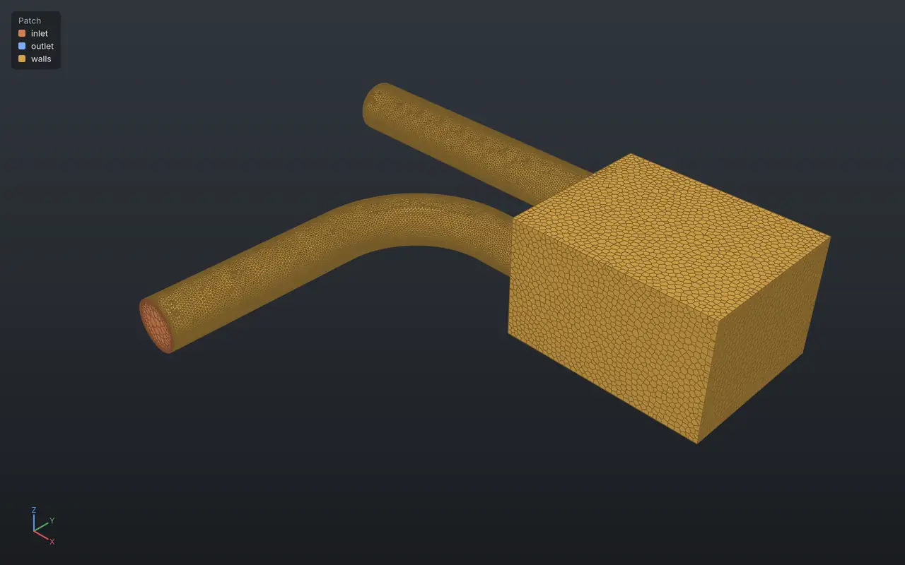

<p align="center">
  
</p>

<h1 align="center">KoflCraft</h1>

<p align="center">
  An open-source polyhedral mesh generator for CFD and multi-physics simulations, written in Rust. The companion mesher of <a href="https://github.com/chiefenne/Foehncraft">Foehncraft</a>.
</p>

<p align="center">
  <a href="docs/gallery.md"></a>
</p>

<sub>KoflCraft's Manifold mesh pictured with <a href="https://github.com/chiefenne/MurmelCraft">MurmelCraft</a>:
229,615 cells, Voronoi polyhedra in the core with prism layers at the
walls. The slides are also [still images with captions](docs/gallery.md);
how they were made is in [tools/readme-tour](tools/readme-tour/README.md).</sub>

---

> **Status: release 0.1.0 (tag `v0.1.0`), the first release.** Milestone M1
> is done and verified: clipped Voronoi polyhedra in a box, validated,
> exported to VTU, Gmsh, OpenFOAM and FoehnCraft, driven from a CLI and an
> MCP server. Convex STL meshing with size control (M2), nonconvex ducts with
> prism layers carried out to the ports (M3 to M5) and a block-structured
> mesher (MB1) work as prototypes, each graded with its gaps on the
> [status page](docs/status.md). What changed is in
> [CHANGELOG.md](CHANGELOG.md); the milestone plan and every decision are in
> [docs/requirements.md](docs/requirements.md).

[](https://github.com/chiefenne/KoflCraft/actions/workflows/m1.yml)
[](https://github.com/chiefenne/KoflCraft/releases)
[](#install)
[](LICENSE)

## What it is for

KoflCraft makes the volume meshes that a cell-centred finite-volume solver
needs: general polyhedral cells, prism layers at walls, named boundary
patches and, later, several cell zones for conjugate heat transfer. Its first
user is [Foehncraft](https://github.com/chiefenne/Foehncraft), which reads
the meshes directly.

The guiding targets are:

- **Correct before fast.** Every mesh is checked before it is written:
  closed cells, matching interior faces, positive volumes, and conservation
  of the total volume and of every patch area. A failed check is never
  reported as success.
- **Polyhedral and layered.** Clipped Voronoi cells in the core, prism layers
  at walls that end cleanly at inlets and outlets, and conformal joins
  between them.
- **Agent-ready.** One Rust engine behind a command line and an MCP server,
  JSON in and out, every result with its evidence: input digests, algorithm,
  version, timings and validation.
- **Graphics-grade geometry.** Algorithms come first from the computer
  graphics and geometry processing community, above all the work of Keenan
  Crane (CMU) and Bruno Lévy (INRIA), and are benchmarked before they are
  adopted.
- **Clean room.** Algorithms implemented from published papers and documented
  formats, MIT licensed, no copyleft code.

## What works today

- **Box meshes (M1, verified).** Clipped Voronoi cells from 16 to 256,000
  sites, clipped by their nearest sites with a completeness test, every
  cell closed, every interior face matched, volume and patch areas
  conserved; repeatable to the bit.
- **Convex STL domains (M2).** STL import and checks, size fields from
  datum objects (points, planes, boxes, spheres, cylinders, cones) and
  coordinate regions, sizes from wall curvature, gaps and feature edges,
  density-weighted CVT seeding.
- **Boundary patches.** `patch.*` tools on any closed STL (planes, boxes,
  normals, feature-angle growing, split, merge, rename, roles), port
  detection on a bare STL, patch proposals, and a FoehnCraft case skeleton
  with the type of every boundary.
- **Nonconvex ducts (M3 to M5, prototypes).** A Rust scaffold (wall remesh,
  Delaunay tetrahedra, boundary recovery), a Voronoi or median-dual
  polyhedral core, prism layers that end on the inlet and outlet planes,
  named wall patches and flush openings, walls without layers or with
  yielding layers, zero-thickness baffles and plates, polygon-prism layers,
  grading, an opt-in hex core; validity by the rules of production
  finite-volume codes. The seven-tube furnace of FoehnCraft's gallery
  builds with 1.9 million cells.
- **Block-structured meshes (MB1).** Templates for a channel, a pipe, an
  elbow, an airfoil C-grid and a multi-element airfoil, TFI and elliptic
  smoothing with wall orthogonality and sliding wall nodes, edit tools and
  a layout optimiser ([docs/block-mesher.md](docs/block-mesher.md)).
- **Hand-off.** `foehncraft.vtkhdf` (blocked VTKHDF, default) or
  `foehncraft.vtu`, Gmsh MSH 4.1, OpenFOAM `polyMesh`, with
  `mesh-evidence.json` and a BLAKE3 hash of every file. FoehnCraft reads
  every acceptance mesh back in CI; MurmelCraft shows them.
- **For agents.** One tool registry behind `kofl` and the MCP server (read
  and write roots), JSON in and out, journal and replay, an exact estimate
  before every build and approvals for large ones ([docs/tools.md](docs/tools.md)).

## Install

### Download a release

*Coming soon.* Ready-to-run programs for macOS, Linux and Windows will be
attached to the [releases](https://github.com/chiefenne/KoflCraft/releases).
Until then, build KoflCraft from source as below.

### Build from source

KoflCraft needs no system libraries, no CMake and no Gmsh; you need Rust
1.88 or newer ([rustup](https://rustup.rs); `rustup update stable` brings
an older one up to date), a C compiler and linker, and Git:

| System | Commands |
|---|---|
| macOS | `xcode-select --install`, then rustup |
| Ubuntu, Debian | `sudo apt install build-essential git curl`, then rustup |
| Fedora | `sudo dnf install gcc make git curl`, then rustup |
| Windows | Visual Studio C++ Build Tools, rustup and Git with `winget install --id ...` (the commands are in the guide) |

The rustup command on macOS and Linux is
`curl --proto '=https' --tlsv1.2 -sSf https://sh.rustup.rs | sh`.

Optional: the [Gmsh](https://gmsh.info) program on the `PATH` for the
extra check of the acceptance run (`cargo m1 --require-gmsh`):
`brew install gmsh` (macOS), `sudo apt install gmsh` (Ubuntu),
`sudo dnf install gmsh` (Fedora), the zip from gmsh.info (Windows).
KoflCraft writes `.msh` files itself and does not need Gmsh otherwise.
The step-by-step guide for each system is
[docs/install.md](docs/install.md).

Then, in a terminal:

```
git clone https://github.com/chiefenne/KoflCraft.git
cd KoflCraft
cargo build --release --locked -p mesh-cli -p mesh-mcp
target/release/kofl generate test-fixtures/box-4.json box.mesh.json
target/release/kofl check box.mesh.json
```

This builds three programs into `target/release/`: `kofl` (the command
line; `kofl mcp` is the MCP server), `mesh-cli` (the same commands under
its older name) and `mesh-mcp` (the MCP server on its own). To call `kofl`
from any folder, install it into `~/.cargo/bin`, which rustup puts on your
`PATH`:

```
cargo install --locked --path crates/mesh-cli
kofl commands
```

To update, pull and build again:

```
git pull --ff-only
cargo build --release --locked -p mesh-cli -p mesh-mcp   # and cargo install ... again if you installed it
```

CI builds and tests on Linux (Ubuntu); macOS and Windows builds are not
checked by CI yet.

## Build and run

With the prerequisites of [Install](#install) in place (Gmsh only for
`--require-gmsh`):

```
cargo test --release --workspace
cargo build --release -p mesh-cli -p mesh-mcp
target/release/mesh-cli generate test-fixtures/box-4.json box.mesh.json
target/release/mesh-cli check box.mesh.json
target/release/mesh-cli export box.mesh.json vtu box.vtu
cargo m1 --require-gmsh
```

## Documentation

| Kind | Where |
|---|---|
| Requirements, decisions and status | [docs/requirements.md](docs/requirements.md) |
| Box meshing, CLI and MCP | [docs/m1-usage.md](docs/m1-usage.md) |
| STL input | [docs/m2-stl.md](docs/m2-stl.md) |
| Block and pipe meshes with wall layers | [docs/analytic-development.md](docs/analytic-development.md) |
| Nonconvex ducts with exposed prism layers | [docs/nonconvex-duct.md](docs/nonconvex-duct.md) |
| Block-structured meshes (templates, smoothing, edit tools) | [docs/block-mesher.md](docs/block-mesher.md) |
| Verification grade and gaps of every feature | [docs/status.md](docs/status.md) |
| Tools of the CLI and the MCP server | [docs/tools.md](docs/tools.md) |
| Changes and releases | [CHANGELOG.md](CHANGELOG.md), [docs/release.md](docs/release.md) |
| Colour maps shared with FoehnCraft and MurmelCraft | [docs/colour-maps.md](docs/colour-maps.md) |
| Rules for agents and contributors | [AGENTS.md](AGENTS.md), [docs/pitfalls.md](docs/pitfalls.md) |

## How it is built

KoflCraft is developed in the way of the
[ArtCraft Craft Anything apps](https://getartcraft.com/apps/craft-anything),
like Foehncraft: Rust, one engine with thin front ends, built step by step
with a coding agent in a study, plan, build, check loop, with every decision
written down in the requirements.

## License

[MIT](LICENSE)
