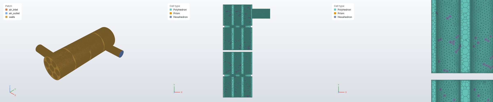
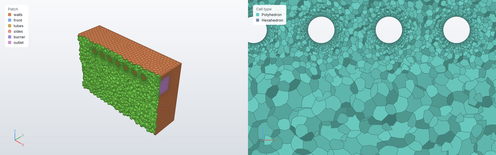
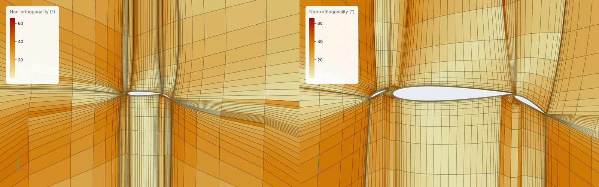

# Application gallery

Real engineering geometries meshed by KoflCraft, each answering how well
the mesher copes with a part as it comes from CAD. Every entry stops at
the mesh: what it checked, what it did not, and the commands that make it
again. The features one by one are in the [Example gallery](gallery.md);
short command sequences are in the [Recipes](recipes.md).

All commands run from the repository root, with `kofl` built by
`cargo build --release -p mesh-cli` (`target/release/kofl`); outputs go to
`out/` and must not exist yet. The pictures are the meshes opened in
[MurmelCraft](https://github.com/chiefenne/MurmelCraft) (headless
`export.image`). The whole page is made again with
`MURMEL=/path/to/murmel python3 tools/gallery/app_gallery.py target/release/kofl target/gallery`
([tools/gallery](../tools/gallery/README.md)); times are from a 4-core
cloud machine.

| # | Application | Mesher | Cells, time |
|---|---|---|---|
| A1 | [Shell side of a shell-and-tube heat exchanger](#heat-exchanger) | polyhedral duct, from a STEP file | 177,994, 78 s |
| A2 | [A seven-tube furnace](#furnace-7) | polyhedral duct, FoehnCraft's gallery 259 | 222,715, 80 s |
| A3 | [A three-element airfoil](#airfoil) | block-structured hexahedra | 3,432, < 1 s |

---

<a id="heat-exchanger"></a>
## A1. Shell side of a shell-and-tube heat exchanger



The maintainer's STEP model ([fixture](../test-fixtures/heat-exchanger/README.md):
a housing, seven tubes, two tube sheets and three baffles, in mm). The
fluid is the empty space of the model, and the air flows between the tube
sheets, around the tubes and through the windows of the baffles, in at
the nozzle at x = −100 and out at x = +100.

KoflCraft has no STEP reader yet (STP-01 to STP-13), so
[make_shell_side.py](../examples/gallery/applications/heat-exchanger/make_shell_side.py)
prepares the fluid with Gmsh as a separate process (`pip install gmsh`):
it closes the housing's inner surface with a disc over each nozzle
opening, fills it, cuts away the tubes, sheets and baffles, keeps the
piece that touches both air nozzles and writes its surface as an STL.
From there on it is KoflCraft: `patch.detect_ports` finds the two nozzle
caps, `patch.rename` gives them the names of the STEP file's cap faces
(`air_inlet`, `air_outlet`), `mesh.setup_duct` writes the partition (here
`size_factor` 4: four times coarser than the default sizes) and
`generate-duct` meshes.

```
mkdir -p out/heat-exchanger && cd out/heat-exchanger
python3 ../../examples/gallery/applications/heat-exchanger/make_shell_side.py \
  ../../test-fixtures/heat-exchanger/SHELL_TUBE_HX.step shell_side.stl
cp ../../examples/gallery/applications/heat-exchanger/*.json .
kofl call patch.detect_ports --input detect.json     # air_inlet and air_outlet are the two caps found
kofl call patch.rename --input rename-inlet.json
kofl call patch.rename --input rename-outlet.json    # -> patches.json
kofl call mesh.setup_duct --input setup.json         # -> partition.json
kofl generate-duct shell_side.stl patches.json partition.json polyhedral mesh --handoff vtu
```

Check:
- The STL has 259,086 triangles and every edge is shared by two (a closed
  shell); its volume, 1,167,972 mm³, matches Gmsh's 1,166,661 mm³.
- Both caps score 0.999 and the next candidate 0.26 (margin 0.74); their
  centres, (−100, 28, 23) and (100, 266, −23), are those of the STEP
  file's `air_inlet` and `air_outlet`. Which is inlet and which outlet is
  a guess the maintainer's file settles.
- The mesh has 177,994 cells, 136,058 of them in the wall layers (the
  baffles and tubes leave 6 and 9 mm gaps, so most of the fluid is within
  a few layers of a wall). No inverted face, 0 of 177,994 cells fail the
  solver rules, and the wall stays within 0.12 mm of the STL both ways.
  The mesh volume is 1,169,648 mm³, 0.14 % above the STL's.
- The cell sizes were not tuned: this is the coarse first mesh.

What this entry is not: the tube side (water) and the solid parts are not
meshed, and the interfaces between the fluids and the tubes (conjugate heat
transfer, MD-06 to MD-18) need the multi-domain mesher, which is not built.
Nor was the STEP file read by KoflCraft: Gmsh did that.

<a id="furnace-7"></a>
## A2. A seven-tube furnace



FoehnCraft's radiation furnace, gallery 259 there: a chamber 4 m long, 2
m deep and 2.5 m high, seven horizontal tubes of 0.16 m diameter under the
roof, a burner disc of 0.5 m diameter in the front wall and a rectangular
opening in the back wall, both flush with their walls. Five layers (first
2 mm, growth 1.2) grow on every wall except the two side walls the tubes
pass through, where the tube layers run straight into the wall
(`"no_layers": ["sides"]`). The geometry and patches (`walls`, `front`,
`tubes`, `sides`, `burner`, `outlet`) come from the fixture's Gmsh script
([fixture](../test-fixtures/furnace/README.md)); entry 57b on the
[polyhedral page](gallery/polyhedral.md#furnace-7) is the same mesh.

```
mkdir -p out/furnace-7-input && cd out/furnace-7-input
sed 's/"Mesh.MeshSizeFromCurvature", 24/"Mesh.MeshSizeFromCurvature", 48/' \
  ../../test-fixtures/furnace/make_furnace.py > make_furnace7.py
python3 make_furnace7.py furnace-7.stl 7
python3 ../../examples/gallery/polyhedral/furnace-7/set_sha256.py furnace-7.stl \
  ../../examples/gallery/polyhedral/furnace-7/partition-7.json partition-7.json
kofl generate-duct furnace-7.stl furnace-7.patches.json partition-7.json polyhedral ../furnace-7 --handoff vtu
```

Check: 170,542 STL facets; 222,715 cells, 156,355 of them in the layers;
no inverted face; volume 19.7209 m³ against 19.7191 m³ of the STL
(+0.009 %); the wall within 0.00075 m of the STL both ways.

<a id="airfoil"></a>
## A3. A three-element airfoil



A slat (NACA 4410, 25°), a NACA 0012 main element and a flap (NACA 4412,
30°) in a hexahedral mesh of 40 blocks: a six-block wall ring around each
element, a cove behind the main element and blocks between them, laid out
by the layout optimiser so the cells in the gaps stay near-orthogonal. The
picture shows each cell's non-orthogonality (the angle between the line
joining two cell centres and the face normal), cut flat through the one
layer of cells the 2-D mesh is extruded in. The exploded view of the same
blocks is [gallery 67](gallery/block.md#multi-element).

```
cd examples/gallery/block/multi-element
kofl call block.template --input template.json
kofl call block.grid --input grid.json           # algorithm elliptic
```

Check: 40 blocks, 3,432 cells; the layout optimiser brings the largest
non-orthogonality from 90.0° to 60.5°, the cells above 70° from 44 to 0 and
the folded corners from 8 to 0 (the numbers of
[gallery 67](gallery/block.md#multi-element), measured on the layout
before and after the optimiser).
