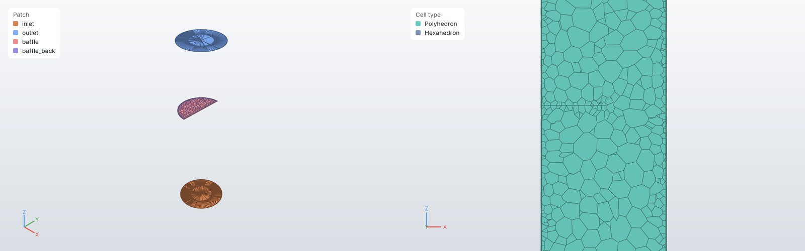
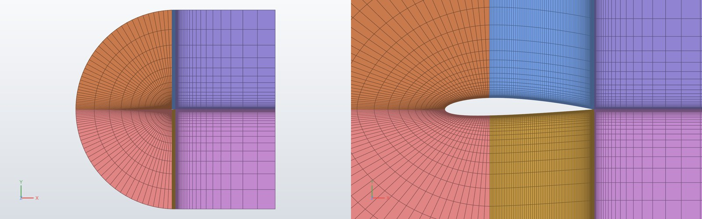
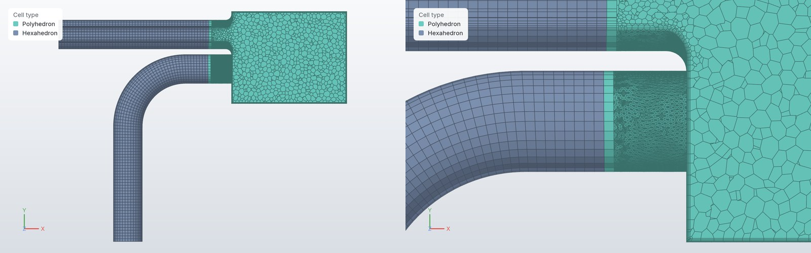

# Example chats

KoflCraft is built to be driven by an AI assistant: every operation is a
tool of the MCP server (`kofl mcp`), with JSON in and out and its evidence
in every answer ([tools](tools.md), [MCP set-up](m1-usage.md#mcp)). This page
shows four recorded chats, each from one sentence of an engineer to a mesh
that FoehnCraft can read.

Each chat lists the calls the assistant made and what came back, its slips
included. The assistant (Claude) drove `kofl mcp` of release 0.3.0 through
[`tools/agent/mcp_host.py`](../tools/agent/mcp_host.py), a minimal MCP host
that records every call. The engineer's lines were written for the
recording; the calls, numbers and refusals are as the server gave them. The
server's own journal of each chat is in
[`examples/agent/`](../examples/agent/README.md), with the commands to replay
it. The pictures are the meshes of the chats in
[MurmelCraft](https://github.com/chiefenne/MurmelCraft), made by
[`tools/agent/render_chats.py`](../tools/agent/render_chats.py).

[Pipe with a baffle](#pipe-baffle) ·
[NACA 2412 for y+ about 1](#naca-yplus) ·
[Manifold with hexahedra in the pipes](#manifold-sweep) ·
[Seven-tube furnace, over the limits](#furnace-7) ·
[Record your own](#record-your-own)

<a id="pipe-baffle"></a>
## 1. A pipe with a baffle, ready for FoehnCraft

> *"Here is pipe.stl, a round pipe 40 long with radius 5, flow along z.
> Put a baffle across the lower half at z = 24, mesh it with prism layers
> for FoehnCraft and give me the case file."*

The STL is bare: one shell of 384 triangles, no names
([make_pipe.py](../examples/gallery/polyhedral/pipe-shells/make_pipe.py)).



| # | Calls | What came back |
|---|---|---|
| 1 | `domain.inspect_stl` | **refused** (`TOOL002`, missing field `config`): the wrong tool, it checks the configuration of a convex STL mesh |
| 2 | `patch.propose` | three faces: a cylinder of radius 5.000 and length 40 (`walls`) and two flat discs at z = 0 and z = 40 (`opening_1`, `opening_2`, opening score 0.9996), each 78.48 in area; next step: give the openings a role |
| 3–6 | `patch.rename` ×2, `patch.set_role` ×2 | `opening_1` (z = 0) is the `inlet`, `opening_2` the `outlet` → `patches.json` |
| 7 | `mesh.setup_duct` | `partition.json`: 3 layers, first 0.016, growth 1.4, cell sizes 0.13 to 1.2, all from the port radius 4.998 |
| 8 | `shell.add` | the baffle, a square from x = −9 to 0 across the pipe at z = 24 (it may reach past the wall), sides `baffle` and `baffle_back` → `partition-baffle.json` |
| 9 | `mesh.estimate` | 30,672 cells (`exact`), about 126 MB of memory and 63 MB of files |
| 10 | `mesh.generate_duct`, polyhedral, `vtu` | **31,882 cells** in 21 s, 0 inverted faces, closure 2.4·10⁻¹⁴, volume 0.099 % below the STL; each side of the baffle 405 faces and 39.24 in area (half the disc is 39.27) |
| 11 | `bc.skeleton` | `case.toml`: `inlet` velocity-inlet (TODO `normal_velocity`), `outlet` static-pressure-outlet (TODO `pressure`), `walls` wall, TODO density and viscosity |
| 12 | `mesh.report` on the mesh folder | **refused** (`IO003`, expected a regular file): it reads saved box artifacts; the duct's numbers are in `mesh/report.json` and `mesh/mesh-evidence.json` |

The assistant's answer: *the mesh is in `mesh/foehncraft.vtu`, 31,882
cells with three prism layers on the pipe wall and polyhedra in the core;
the baffle is a zero-thickness wall with the patches `baffle` and
`baffle_back`. In `case.toml` fill in the inlet velocity, the outlet
pressure and the fluid. Note: `bc.skeleton` does not know the baffle yet,
so I added `[boundary.baffle]` and `[boundary.baffle_back]` as walls by
hand; and the estimate was 4 % low (30,672 for 31,882 cells).*

<a id="naca-yplus"></a>
## 2. A NACA 2412 C-grid for y+ about 1

> *"I need a structured mesh around a NACA 2412 for a 2D run at Re = 3
> million, chord 1 m, with y+ about 1 at the wall."*

The assistant first worked out the wall spacing from a flat-plate
estimate: c_f = 0.0576 Re^−0.2 = 0.0029, u_τ/U = √(c_f/2) = 0.038, so
y = y+ · c / (Re · u_τ/U) ≈ 9·10⁻⁶ m; it chose 1·10⁻⁵ m.



| # | Calls | What came back |
|---|---|---|
| 1 | `block.template` `airfoil_cgrid`, NACA 2412, far field and wake 20 chords, 120 cells along the surface, 60 off it, 40 in the wake, `wall_spacing` 1·10⁻⁵ | six blocks, 19,200 cells, the topology checked (`naca.json`) |
| 2 | `block.grid` elliptic with wall sliding | **failed** after 183 s (`MESH003`): elliptic smoothing did not converge in 10,000 iterations; the fix says raise `max_iterations` or use TFI |
| 3 | `block.grid` TFI | 0.3 s: **19,200 hexahedra**, every corner Jacobian positive, 0 inverted faces, volume 0.019 % from the analytic one, min scaled Jacobian 0.48, wall angle 14.6° mean and 60.2° at most, patches `airfoil_wall`, `inlet`, `outlet` and the two `symmetry` sides |
| 4 | `block.grid` elliptic without wall sliding | **failed** after 185 s (`MESH003`), last change 0.025 of the shortest edge |
| 5 | `block.grid` elliptic with wall sliding, `max_iterations` 30,000 | **failed** after 583 s (`MESH003`), last change 0.012 |
| 6–7 | `block.template` with `wall_spacing` 1·10⁻⁴, `block.grid` elliptic with wall sliding | **failed** after 176 s (`MESH003`): not the first spacing alone |

The assistant's answer: *the TFI grid in `naca-tfi/` is valid and has
the 10 µm first cell (y+ about 1), but its cells meet the wall at up to 60°
near the block corners. The elliptic smoother, which would make them
orthogonal, does not converge on this grid, at 10 µm or at 0.1 mm, with a
far field 20 chords out; the gallery's C-grid (far field 5 chords, 1 mm)
does converge ([gallery 44b](gallery/block.md#naca-cgrid)). Use the TFI grid
for a first run, or try a closer far field for the smoothed one.*

<a id="manifold-sweep"></a>
## 3. The Manifold with hexahedra in the pipes

> *"Mesh the Manifold with hexahedra wherever the pipes allow it and
> polyhedra in the rest, all in one mesh."*

The Manifold's STL and patch map (`inlet`, `outlet`, `walls`) are in
[test-fixtures/manifold](../test-fixtures/manifold/README.md).



| # | Calls | What came back |
|---|---|---|
| 1 | `regions.propose` with a picture | 15 s: a tet scaffold (110,103 tetrahedra), the wall distance and the inlet-to-outlet potential; three regions: the chamber as a `box` (72.3 % of the volume), two pipes as `sweep` (11.1 % and 16.6 %); the second pass finds sweeps for 42 % of the domain inside the box. Nothing meshed yet |
| 2 | `mesh.estimate` for `regions.fill` | **refused** (`TOOL002`, no estimate for regions.fill): the sweep fill has no estimate yet |
| 3 | `regions.fill` | 34 s: **132,520 cells**, 69,632 hexahedra in the two pipes (min scaled Jacobian 0.70) and 62,888 polyhedra in the box, joined conformally at two calm planar cuts; 0 inverted faces, closure 1.9·10⁻¹⁴, volume 0.17 % below the STL. Non-orthogonality: 23.5° between hexahedra, 48.2° at the cuts, 87.7° between polyhedra (393 faces above 70°) |

The assistant's answer: *one conformal mesh, `mesh/foehncraft.vtu`: the
pipes are swept O-grids with five wall layers, the box is polyhedral. The
worst cells are inside the box (87.7°), not at the joins (48.2°); if your
solver struggles there, the box is where to refine.*

<a id="furnace-7"></a>
## 4. The seven-tube furnace: a limit, a policy and an approval

> *"Mesh FoehnCraft's seven-tube furnace (furnace-7.stl and its patch map)
> with five layers, first cell 2 mm, growth 1.2. The tubes pass through the
> two side walls."*

The STL (170,542 triangles, 8.5 MB) and its patch map come from the
fixture's Gmsh script, as in [application A2](applications.md#furnace-7).
This chat shows the server's guard rails: limits on what a tool may read,
and a question to the engineer before a build over the limits.

| # | Calls | What came back |
|---|---|---|
| 1 | `patch.list` | **refused** (`IO003`, file exceeds the size limit): the server reads at most 8 MiB per file. The assistant asked the engineer to raise the limit in a policy file outside the write root (below) and to restart the server with `--policy` |
| 2 | `patch.list` | six patches, every facet in one: `walls`, `front`, `tubes` (7 regions, 149,948 facets), `sides` (2 regions), `burner` (inlet), `outlet` |
| 3 | `mesh.setup_duct` with `layers` 5, `first_thickness` 0.002, `growth` 1.2 | `partition.json`, sizes 0.0065 to 0.06 m from the smaller port radius (the burner, 0.25 m) |
| — | (file edit) | `mesh.setup_duct` has no field for walls without layers, so the assistant wrote `partition-sides.json` with `"no_layers": ["sides"]` added: the tube layers run straight into the side walls |
| 4 | `mesh.estimate` (on `partition.json`) | 54 s: 468,672 cells (`exact`), 1.9 GB of memory, 960 MB of files |
| 5 | `mesh.generate_duct`, polyhedral, `vtu` | **the server asked**: *"This build is over the MCP limits. Start it anyway? mesh.generate_duct would build 421687 cells and write about 863 MB (limits: 500000 cells, 1073 MB); mcp accepts at most 100000 source facets, got 170542"*. The engineer said yes (the journal holds the refused try, `TOOL008`, and the approved run); 252 s: **421,688 cells**, 272,820 of them in the layers, 0 inverted faces, volume 0.006 % above the STL, the wall within 0.55 mm of the STL both ways; the result carries the limitation *built over the MCP limits with approval* |

The policy file the engineer wrote (`kofl-mcp.toml`, next to the project
folder, not inside it):

```toml
# Limits for the furnace study: its STL is 8.5 MB, above the server's
# 8 MiB read limit. Builds over the other limits still ask first.
[limits]
max_file_bytes = 16777216
```

The assistant's answer: *421,688 cells with five layers on the walls, the
front, the tubes and the openings, none on the two side walls. It is about
twice the cells of the gallery mesh (222,715), because `mesh.setup_duct`
sizes the cells from the burner radius; the gallery partition uses coarser
core cells. Two things to know: the estimate of the files was 863 MB, the
files on disk are 1.9 GB (`foehncraft.vtu` 741 MB, `mesh.msh` 1.19 GB);
and the approval held for this one build only.*

<a id="record-your-own"></a>
## Record your own

Start the server once through the host, then send calls from a shell (the
assistant does the same through its own MCP connection):

```
cd ~/cfd/pipe
python3 tools/agent/mcp_host.py serve /tmp/kofl.sock transcript.jsonl -- \
    kofl mcp --read-root ~/cfd/pipe --write-root ~/cfd/pipe --journal journal.jsonl
python3 tools/agent/mcp_host.py call /tmp/kofl.sock patch.propose '{"surface": "pipe.stl", "output": "proposed.json"}'
python3 tools/agent/mcp_host.py call /tmp/kofl.sock mesh.generate_duct '{...}' --approve yes
python3 tools/agent/mcp_host.py stop /tmp/kofl.sock
```

`--approve yes` or `no` answers the server's question for a build over the
limits; without it the host cancels the question and the build is refused
(`TOOL010`). Relative paths resolve from the first write root. To register
`kofl mcp` with an assistant directly, see [MCP](m1-usage.md#mcp); to run a
recorded journal again, `kofl call journal.replay` (outputs must not exist
yet, see [examples/agent](../examples/agent/README.md)).
