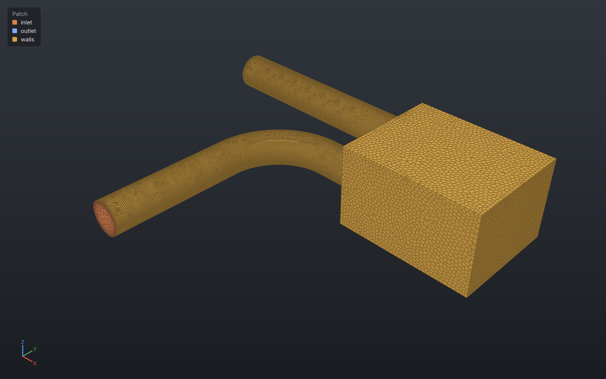
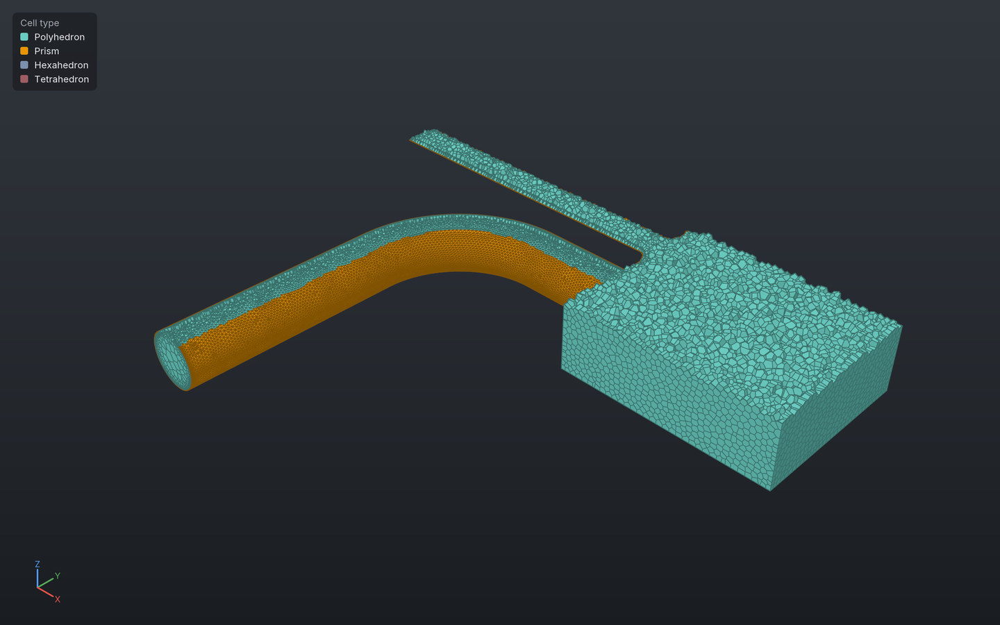
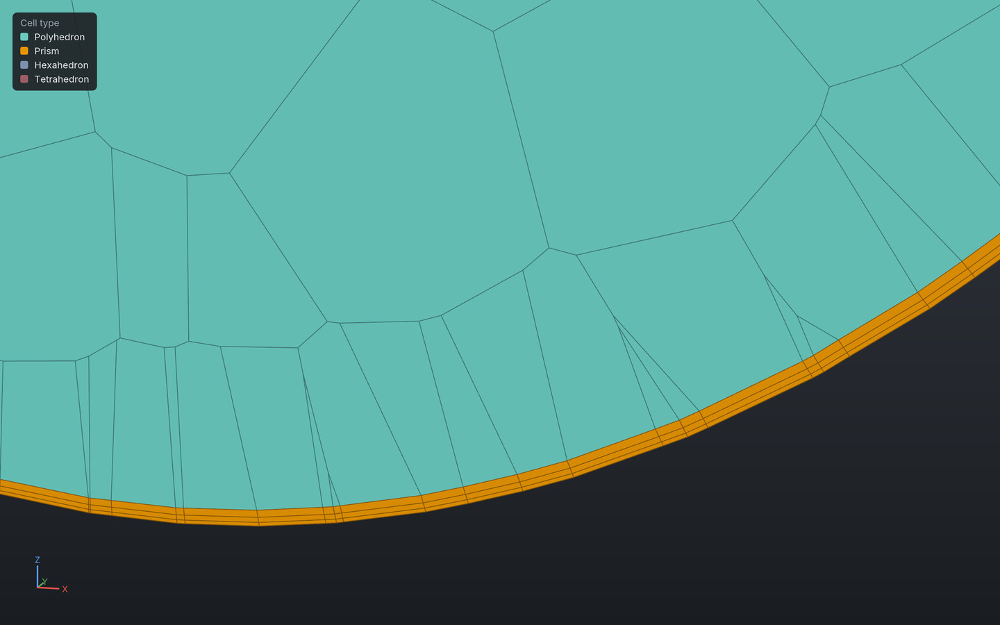
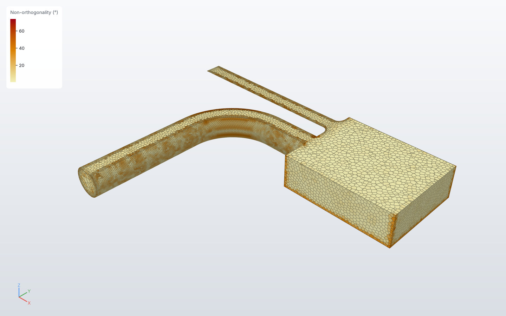
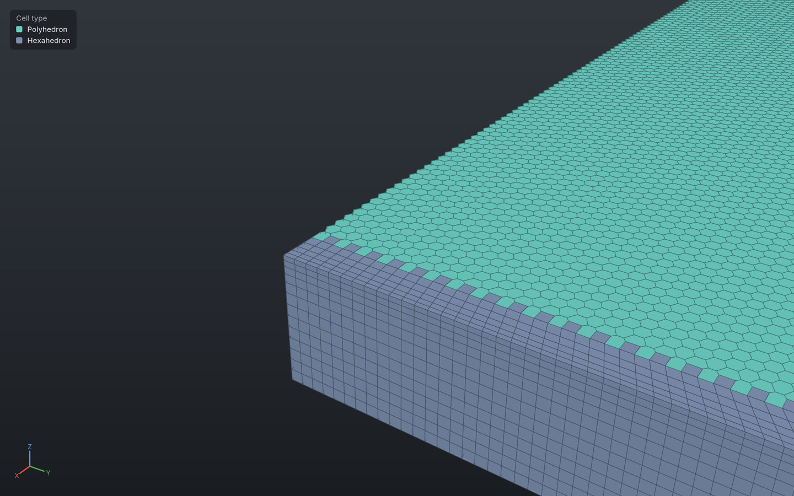
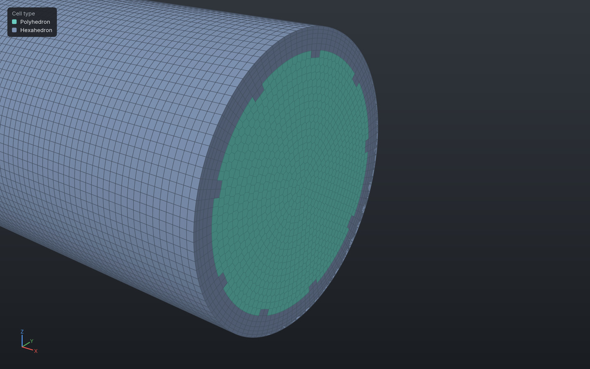
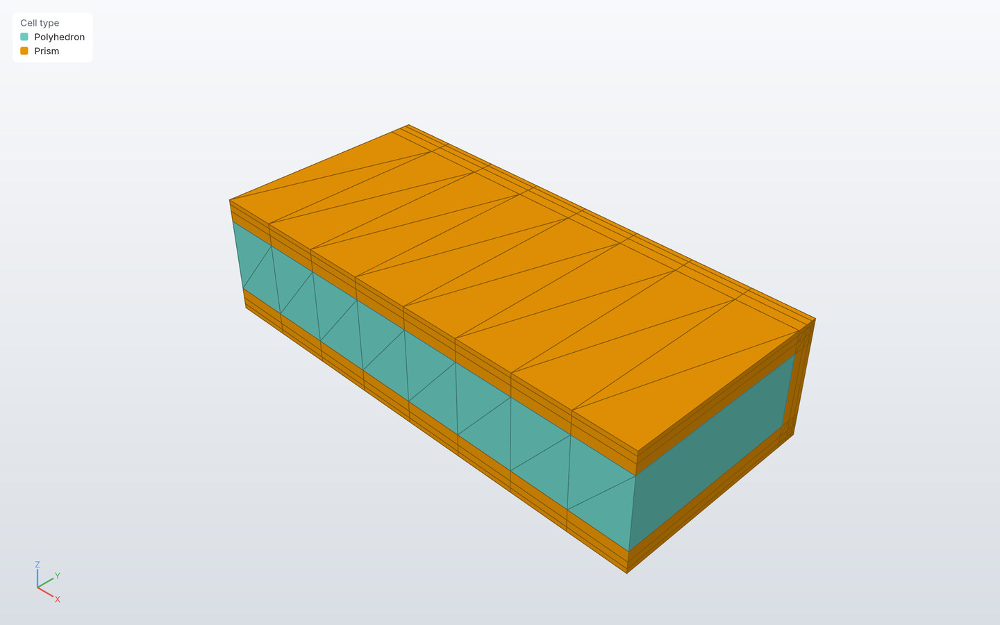
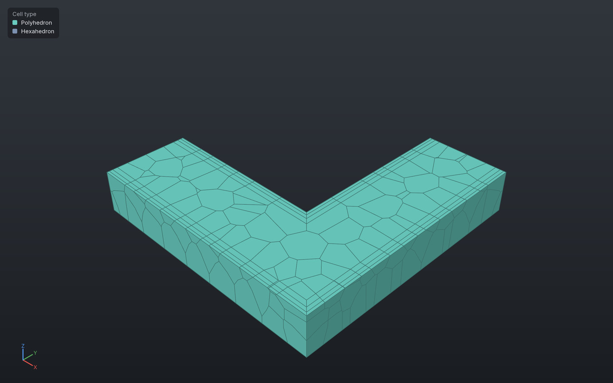

# Gallery

The slides of the README's slideshow as still images. Every picture is a
KoflCraft mesh opened in [MurmelCraft](https://github.com/chiefenne/MurmelCraft)
and written by its headless `export.image` (2560 x 1600, scaled to
1440 x 900), set up by [tools/readme-tour](../tools/readme-tour/README.md).
The meshes come from the fixtures in this repository; the commands are in
[make-tour.sh](../tools/readme-tour/make-tour.sh).

## The Manifold duct

The user-supplied Manifold STL (a pipe with a bend, a box, a rounded
junction and an outlet pipe) meshed by `generate-duct … polyhedral`:
229,615 cells with the inlet, outlet and wall patches.

## Cell types under a clip plane

Voronoi polyhedra (89,467) in the core and prism layers (140,105) at the
walls, cut by a crinkle clip that keeps whole cells.

## Prism layers at the wall

A flat cut across the inlet pipe near the wall: the prism layers grow off
the wall and join the polyhedral core conformally.

## Cell quality

Face non-orthogonality of every cell on the cut, the check a finite-volume
solver cares about most.

## A swept block

`generate-sweep test-fixtures/analytic/block.json`: a polyhedral section
swept through the height, with hexahedral layers at the walls (161,135
cells).

## A swept pipe with an O-grid

`generate-sweep test-fixtures/analytic/pipe.json`: hexahedral O-grid layers
round a polyhedral core (191,280 cells).

## A straight channel

`generate-channel test-fixtures/straight-channel.json`: three prism layers
on each wall round the core (776 cells).

## An elbow

The elbow fixture meshed by `generate-duct … polyhedral` (1,004 cells), cut
flat at mid-height.
