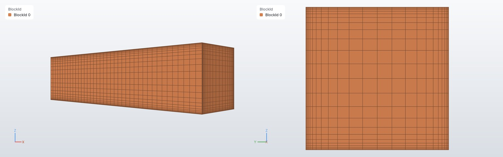
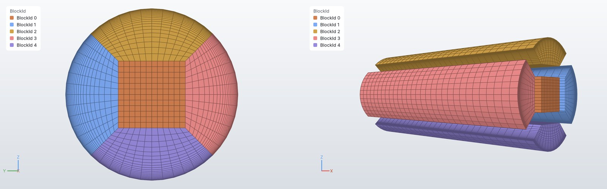
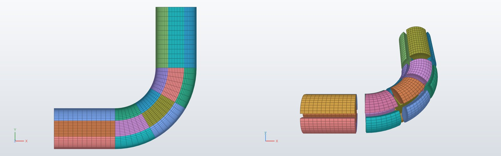
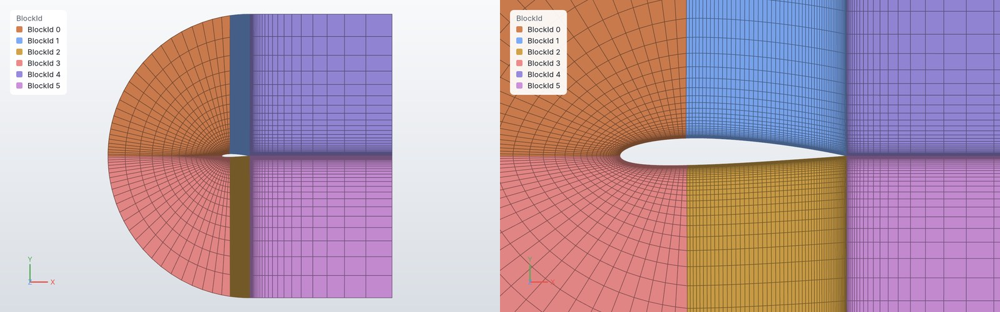
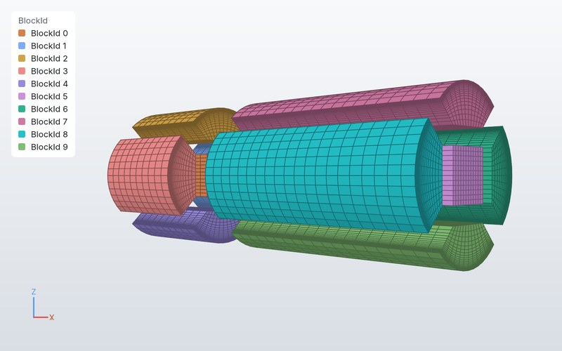
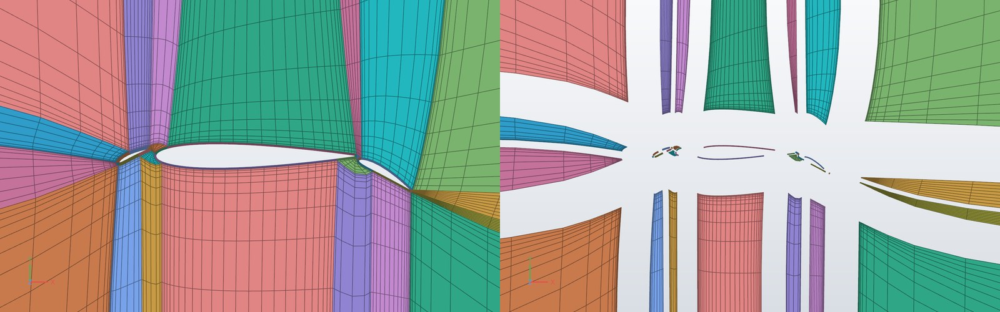
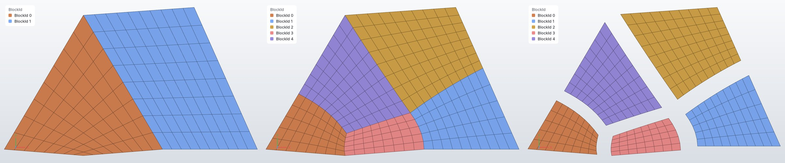
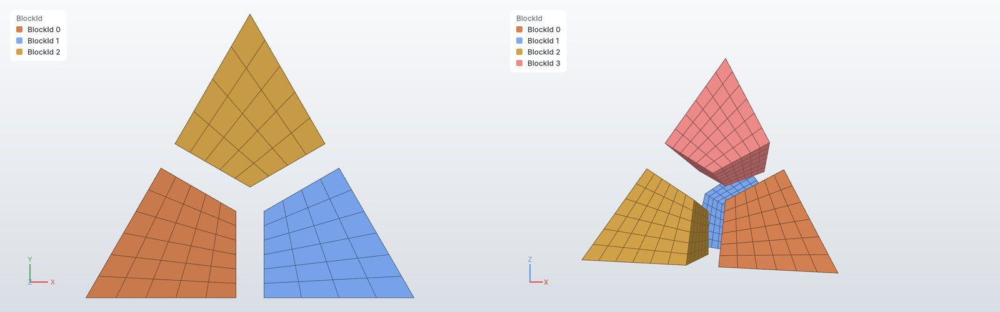

# Block-structured meshes

Part of the [Example gallery](../gallery.md): multi-block hexahedral meshes
from KoflCraft's block mesher ([block-mesher.md](../block-mesher.md)),
built from templates and edited with the `block.*` tools. Each picture is
the mesh's `volume.vtu` opened in
[MurmelCraft](https://github.com/chiefenne/MurmelCraft), coloured by block
(`display.color_by` `category`, field `BlockId`) and, where it says so,
exploded (`display.explode`), written by its headless `export.image`.

Every entry runs from the folder of its inputs in
[examples/gallery/block/](../../examples/gallery/block/). `kofl` is
`target/release/kofl` (`cargo build --release -p mesh-cli`), and outputs
must not exist yet. The whole page is made again with
`MURMEL=/path/to/murmel python3 tools/gallery/block_gallery.py target/release/kofl target/gallery`
([tools/gallery](../../tools/gallery/README.md)). How to explode and colour
your own block mesh in MurmelCraft: [recipe NNN](../recipes/block.md#explode-blocks).

| # | Example | Template or tool | Blocks, cells |
|---|---|---|---|
| 37 | [A channel with two-sided wall clustering](#channel) | `channel` | 1, 23,040 |
| 37b | [A pipe as an O-grid](#pipe-ogrid) | `pipe_ogrid` | 5, 36,000 |
| 44 | [A 90° elbow](#elbow) | `elbow` | 25, 39,360 |
| 44b | [A C-grid around a NACA 2412](#naca-cgrid) | `airfoil_cgrid`, elliptic with wall sliding | 6, 8,800 |
| 48 | [Splitting the core of a pipe](#pipe-split) | `block.split_block` | 10, 36,000 |
| 67 | [A three-element airfoil with an optimised layout](#multi-element) | `multi_element_airfoil` | 40, 3,432 |
| 71 | [A flat corner split into three blocks](#triangle-split) | `block.optimize_layout`, `block.split_triangle` | 2 → 5, 144 → 274 |
| 71b | [A triangle and a tetrahedron as hexahedra](#tri-center) | `triangle`, `tetrahedron` | 3, 74; 4, 864 |

Every mesh below passed the block mesher's checks: positive Jacobians at
every hexahedron corner, conforming faces, the cell volumes summing to the
volume the boundary encloses, and no inverted face.

---

<a id="channel"></a>
## 37. A channel with two-sided wall clustering



One block, the simplest template: cells shrink toward the four walls from
a first height of 0.3 mm (`wall_spacing`), so a wall-resolved RANS case
starts from here.

```
kofl call block.template --input template.json   # channel/
kofl call block.grid --input grid.json
```

Check: 23,040 cells, minimum scaled Jacobian 1.0 (every cell a box),
largest aspect ratio 27.8 at the walls.

<a id="pipe-ogrid"></a>
## 37b. A pipe as an O-grid



A square core (an H-block) and four O-grid blocks to the wall avoid the
degenerate cells at the axis of a polar grid. The exploded view shows the
five blocks; the elliptic smoother makes the grid lines meet the wall at
right angles.

```
kofl call block.template --input template.json   # pipe/
kofl call block.grid --input grid.json           # algorithm elliptic
```

Check: 36,000 cells, minimum scaled Jacobian 0.707 (the core's corners),
first cell 0.15 mm at the wall.

<a id="elbow"></a>
## 44. A 90° elbow



The pipe O-grid swept through a bend of radius 0.15 m, with straight inlet
and outlet legs. The walls are projected onto the cylinders and the torus,
so the wall nodes lie on the true surface.

```
kofl call block.template --input template.json   # elbow/
kofl call block.grid --input grid.json           # algorithm elliptic
```

Check: 25 blocks, 39,360 cells, minimum scaled Jacobian 0.706.

<a id="naca-cgrid"></a>
## 44b. A C-grid around a NACA 2412



Six blocks around a NACA 4-digit airfoil (or a Selig or Lednicer
coordinate file), the farfield 5 chords out and a wake of 5 chords. The
elliptic smoother with `wall_sliding` moves the wall nodes along the
contour until the grid lines leave the wall at right angles.

```
kofl call block.template --input template.json   # naca/
kofl call block.grid --input grid-tfi.json       # the TFI grid, for comparison
kofl call block.grid --input grid.json           # elliptic, wall sliding
```

Check: 8,800 cells; the largest angle between a grid line and the wall
normal falls from 60.7° (TFI) to 8.9° (`report.json`, `smoothing.wall_angle_deg`),
the minimum scaled Jacobian rises from 0.47 to 0.57.

<a id="pipe-split"></a>
## 48. Splitting the core of a pipe



The edit tools change a topology without rebuilding it. `block.split_block`
cuts the core block (block 0) after 10 of its 30 axial cells, and the
split runs through the whole chain of blocks that share those edges, so
the topology stays point-matched: five blocks become ten.

```
kofl call block.template --input ../pipe/template.json   # pipe.json
kofl call block.split_block --input split.json           # pipe-split/
kofl call block.grid --input grid.json
```

Check: 10 blocks, 36,000 cells (the cell count does not change).

<a id="multi-element"></a>
## 67. A three-element airfoil with an optimised layout



A slat (NACA 4410, 25°) and a flap (NACA 4412, 30°) around a NACA 0012.
Each element gets a six-block wall ring, the main element a cove, and the
layout optimiser (`block::layout`) moves the inner vertices and bends the
inner edges toward orthogonal cells. The exploded view shows how the 40
blocks fit around the gaps.

```
kofl call block.template --input template.json   # multi-element/
kofl call block.grid --input grid.json           # algorithm elliptic
```

Check (the template's `layout` report): largest non-orthogonality of the
TFI grid 90.0° → 60.5°, cells over 70° 44 → 0, folded corners 8 → 0.

<a id="triangle-split"></a>
## 71. A flat corner split into three blocks



A block with a corner close to 180° is a triangle in disguise and gives
skewed cells. `block.optimize_layout` finds such corners (150° or more),
tries the tri-center split (three blocks around a centre, a new row of
cells running through the neighbours to the boundary) together with the
layout optimiser, and keeps it only where the grid measurably improves.

```
kofl call block.grid --input grid-before.json        # triangle-split/
kofl call block.optimize_layout --input optimize.json
kofl call block.grid --input grid-after.json
```

To split a block by hand instead: `kofl call block.split_triangle --input
split-by-hand.json` (`block`, `vertex` of the flat corner, optionally the
`cells` of the new row). Turn the automatic split off with
`"triangle_splits": false` in `optimize.json`.

Check (`result.layout` of `block.optimize_layout`): largest
non-orthogonality 64.0° → 26.2°; kept: block 0 at vertex 1 (170.9°);
skipped: a second candidate at 163.9° whose worst angle improved by less
than 2°. Minimum scaled Jacobian 0.16 → 0.78.

<a id="tri-center"></a>
## 71b. A triangle and a tetrahedron as hexahedra



The building blocks of the split: a triangle (extruded) as three
hexahedral blocks and a tetrahedron as four, around the centroid. `cells`
gives one count per corner; the edge from corner i to corner j gets
`cells[i] + cells[j]`.

```
kofl call block.template --input template-triangle.json      # tri-center/
kofl call block.grid --input grid-triangle.json
kofl call block.template --input template-tetrahedron.json
kofl call block.grid --input grid-tetrahedron.json
```

Check: triangle 74 cells, minimum scaled Jacobian 0.866; tetrahedron 864
cells, 0.707, volume conserved to 10⁻¹⁰. Automated tests:
`cargo test -p mesh-algorithms tri_center`, `cargo test -p mesh-engine
block_triangle`, `cargo test -p mesh-cli --test kofl tri_center`.
