# Polyhedral and layered meshes

Part of the [Example gallery](../gallery.md): unstructured meshes from
KoflCraft's Voronoi and median-dual generators, from a box with four sites
up to FoehnCraft's seven-tube furnace. Each picture is the mesh's
`foehncraft.vtu` (or the exported `.vtu`) opened in
[MurmelCraft](https://github.com/chiefenne/MurmelCraft), coloured by patch
or by cell type, cut open with a clip plane where it says so, and written
by its headless `export.image`.

Every entry runs from the repository root. `kofl` is `target/release/kofl`
(`cargo build --release -p mesh-cli`), outputs go to `out/` and must not
exist yet. The inputs are the test fixtures in
[test-fixtures/](../../test-fixtures/) and the files in
[examples/gallery/polyhedral/](../../examples/gallery/polyhedral/). The
whole page is made again with
`MURMEL=/path/to/murmel python3 tools/gallery/poly_gallery.py target/release/kofl target/gallery`
([tools/gallery](../../tools/gallery/README.md)); the times below are
from that run on a 4-core cloud machine.

Entries M1 to M3 come from milestones before this repository's pull
request history starts; the others carry the number of the pull request
that added the feature.

| # | Example | Command or tool | Cells, time |
|---|---|---|---|
| M1 | [Four Voronoi cells in a box](#box) | `generate` | 4, < 0.1 s |
| M1b | [A layered channel](#channel) | `generate-channel` | 776, < 0.1 s |
| M1c | [A graded pipe and block](#sweep) | `generate-sweep` | 191,280 and 161,135, 3 s each |
| M2 | [A convex STL with a size field](#convex-stl) | `generate-stl` | 495, 1 s |
| M3 | [One elbow, three modes](#elbow) | `generate-duct` bulk, layered, polyhedral | 52, 172, 1,054 |
| 26 | [The Manifold duct](#manifold) | `generate-duct` polyhedral | 137,682, 47 s |
| 30 | [From a bare STL](#bare-stl) | `patch.detect_ports`, `mesh.setup_duct` | 59,012, 26 s |
| 57 | [A furnace with flush openings](#furnace) | named patches, `no_layers` | 16,450, 5 s |
| 57b | [The seven-tube furnace](#furnace-7) | FoehnCraft gallery 259 | 222,715, 78 s |
| 60 | [Yielding layers and a hex core](#furnace-variants) | `layers_yield`, `hex_core` | 38,276 and 17,732, 5 s each |
| 70 | [Baffle, plate and probe in a pipe](#pipe-shells) | `patch.propose`, `bc.skeleton`, `shell.add`, `grading.add` | 34,368, 20 s |

Every mesh below has no inverted face and passes the solver rules
KoflCraft checks before it writes the hand-off (`mesh-evidence.json`,
`summary.inverted_faces` 0).

---

<a id="box"></a>
## M1. Four Voronoi cells in a box

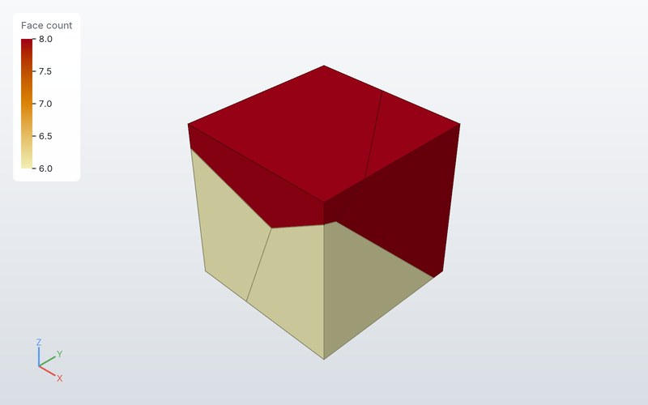

The smallest case: a unit box and four sites, clipped Voronoi cells that
fill the box exactly. It is the reference for the polyhedral cell format
every larger mesh uses.

```
kofl generate test-fixtures/box-4.json out/box.json
kofl export out/box.json vtu out/box.vtu
```

Check: 4 cells, total volume 1 to roundoff (`kofl check out/box.json`).

<a id="channel"></a>
## M1b. A layered channel

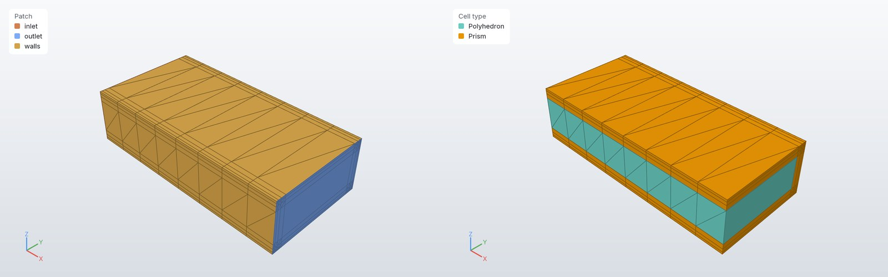

A rectangular channel with wall layers on four sides, inlet and outlet,
written as a bundle for FoehnCraft.

```
kofl generate-channel test-fixtures/straight-channel.json out/channel --handoff vtu
```

Check: 776 cells, volume 8 to roundoff, patches `inlet`, `outlet`,
`walls`. Without `--handoff vtu` the hand-off is `foehncraft.vtkhdf`.

<a id="sweep"></a>
## M1c. A graded pipe and block

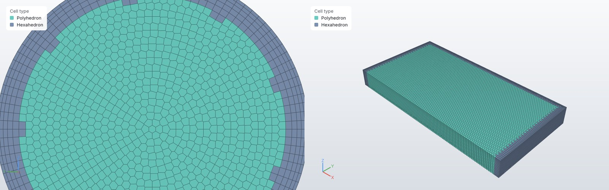

Analytic sweeps: a round pipe of 50 mm diameter, 150 mm long, and a
rectangular block with one inlet, both with five wall layers (first 0.48
mm, growth 1.2) and a core graded to the layers.

```
kofl generate-sweep test-fixtures/analytic/pipe.json out/sweep-pipe --handoff vtu
kofl generate-sweep test-fixtures/analytic/block.json out/sweep-block --handoff vtu
```

Check (`report.json`): pipe 191,280 cells (64,800 in the layers),
maximum non-orthogonality 2.5°, volume 0.056 % below the true cylinder;
block 161,135 cells, maximum non-orthogonality 44.7°, volume exact.

<a id="convex-stl"></a>
## M2. A convex STL with a size field

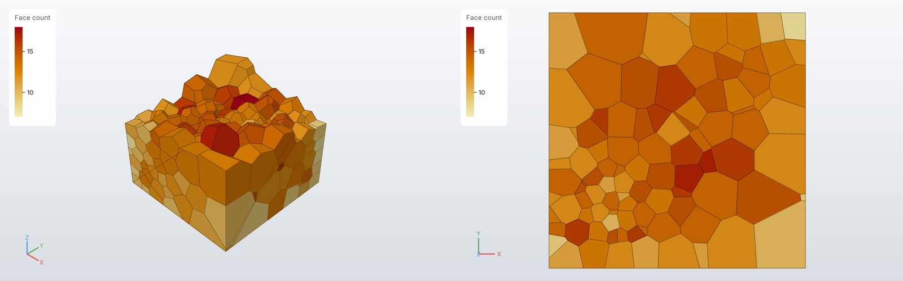

A closed convex STL meshed with a size field: a point datum (`probe`,
size 0.06 near (0.25, 0.25, 0.25)) and a coordinate region (`band`, a
diagonal slab of size 0.1 in its own frame), 0.25 elsewhere.

```
kofl generate-stl test-fixtures/unit-box.stl test-fixtures/stl-size-field.json out/stl.json
kofl export out/stl.json vtu out/stl.vtu
```

Check: 495 cells, volume 1 to roundoff (`kofl check out/stl.json`). The
size sources are described in [m2-stl.md](../m2-stl.md).

<a id="elbow"></a>
## M3. One elbow, three modes

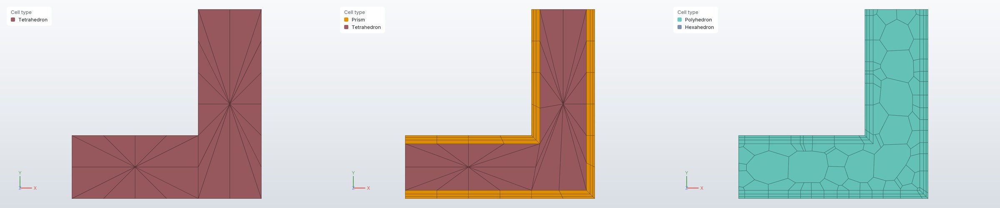

The same STL, patch map and partition in the three modes of
`generate-duct`: `bulk` (tetrahedra), `layered` (tetrahedra and prism
layers on every wall triangle) and `polyhedral` (a median-dual core with
wall layers, the default for FoehnCraft).

```
E=test-fixtures/elbow
kofl generate-duct $E/elbow.stl $E/patches.json $E/partition.json bulk out/elbow-bulk --handoff vtu
kofl generate-duct $E/elbow.stl $E/patches.json $E/partition.json layered out/elbow-layered --handoff vtu
kofl generate-duct $E/elbow.stl $E/patches.json $E/partition.json polyhedral out/elbow-polyhedral --handoff vtu
```

Check: 52, 172 (120 prisms) and 1,054 cells, volume 5 in all three.

<a id="manifold"></a>
## 26. The Manifold duct

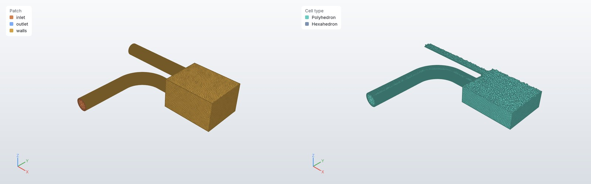

A real nonconvex STL (90,894 triangles) with pipe roundings and sharp
edges. The wall is remeshed in Rust onto the STL to a chord tolerance of
0.05 and the volume built from it; the patch map and partition are made
by hand ([fixture](../../test-fixtures/manifold/README.md)).

```
M=test-fixtures/manifold
kofl generate-duct $M/manifold.stl $M/patches.json $M/partition.json polyhedral out/manifold --handoff vtu
```

Check: 137,682 cells (88,428 in the wall layers), wall within 0.050 of
the STL both ways (`scaffold.wall_deviation`), volume 0.029 % below the
STL.

<a id="bare-stl"></a>
## 30. From a bare STL

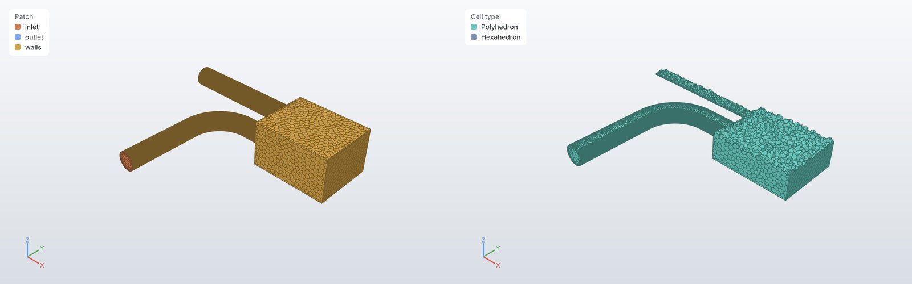

The same STL with no patch map and no partition: `patch.detect_ports`
finds the two pipe end caps (score 1.0 each, the next candidate 0.78),
and `mesh.setup_duct` writes a partition sized from the smaller port,
here twice as coarse (`size_factor` 2).

```
mkdir -p out/bare && cp test-fixtures/manifold/manifold.stl out/bare/ && cd out/bare
echo '{"surface": "manifold.stl", "output": "ports.json"}' > detect.json
kofl call patch.detect_ports --input detect.json
echo '{"surface": "manifold.stl", "patches": "ports.json", "output": "partition.json", "size_factor": 2}' > setup.json
kofl call mesh.setup_duct --input setup.json
kofl generate-duct manifold.stl ports.json partition.json polyhedral mesh --handoff vtu
```

Check: 59,012 cells, wall within 0.10 of the STL, volume 0.065 % below
the STL. Which cap is the inlet is a guess: check the centres in the
result and pass `inlet` and `outlet` to swap them
([nonconvex-duct.md](../nonconvex-duct.md#from-a-bare-stl)).

<a id="furnace"></a>
## 57. A furnace with flush openings

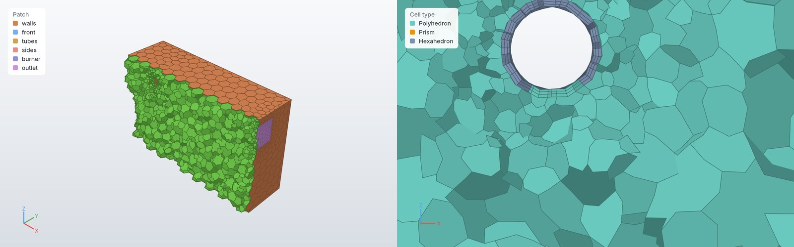

FoehnCraft's radiation furnace (gallery 259) with one tube: a burner disc
and an outlet flush with their walls, six named patches (`walls`,
`front`, `tubes`, `sides`, `burner`, `outlet`), three layers on every
wall except the side walls (`"no_layers": ["sides"]`, PR #59), so the
tube layers run straight into them.

```
F=test-fixtures/furnace
kofl generate-duct $F/furnace.stl $F/furnace.patches.json $F/partition.json polyhedral out/furnace --handoff vtu
```

Check: 16,450 cells, every patch keeps its name and role in the hand-off
(the burner is a `velocity-inlet`, the outlet a `static-pressure-outlet`).

<a id="furnace-7"></a>
## 57b. The seven-tube furnace

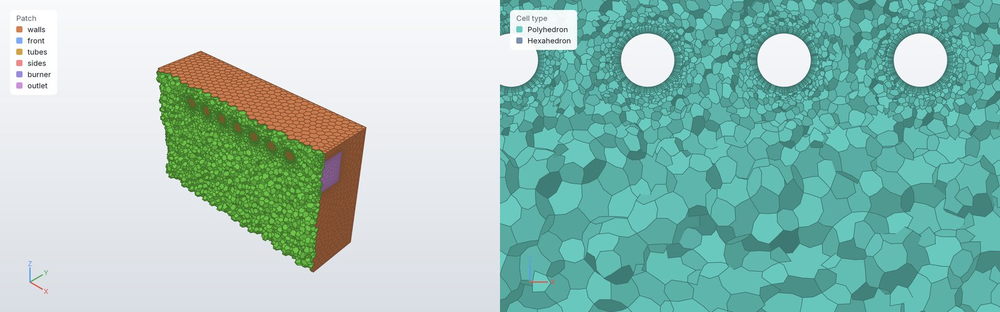

The furnace of FoehnCraft's gallery 259 as FoehnCraft runs it: seven
tubes, five layers (first 2 mm, growth 1.2), wall sizes 0.021 to 0.125 m.
The STL is made with Gmsh (`pip install gmsh numpy`); `set_sha256.py`
writes the STL's hash into the partition.

```
mkdir -p out/furnace-7-input && cd out/furnace-7-input
sed 's/"Mesh.MeshSizeFromCurvature", 24/"Mesh.MeshSizeFromCurvature", 48/' \
  ../../test-fixtures/furnace/make_furnace.py > make_furnace7.py
python3 make_furnace7.py furnace-7.stl 7
python3 ../../examples/gallery/polyhedral/furnace-7/set_sha256.py furnace-7.stl \
  ../../examples/gallery/polyhedral/furnace-7/partition-7.json partition-7.json
kofl generate-duct furnace-7.stl furnace-7.patches.json partition-7.json polyhedral ../furnace-7 --handoff vtu
```

Check: 170,542 STL facets, 222,715 cells (156,355 in the layers), wall
within 0.00075 m of the STL, built in 78 s.

<a id="furnace-variants"></a>
## 60. Yielding layers and a hex core

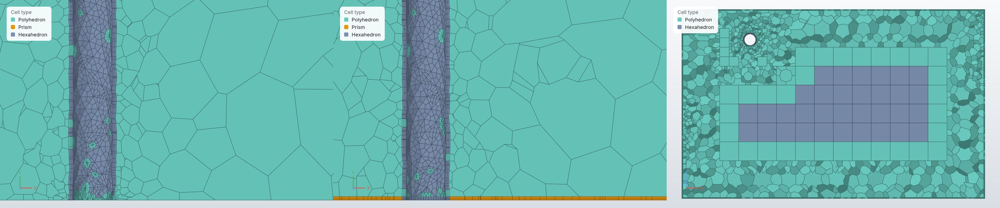

Two opt-in variants of the furnace partition. `"layers_yield": ["sides"]`
(PR #60) keeps the side walls' layers and lets the tube layers run
through them; `"core": "hex_core"` (PR #68) fills the bulk with the cubes
of a balanced octree and joins them to the layers with the median dual.

```
F=test-fixtures/furnace V=examples/gallery/polyhedral/furnace-variants
kofl generate-duct $F/furnace.stl $F/furnace.patches.json $V/partition-yield.json polyhedral out/furnace-yield --handoff vtu
kofl generate-duct $F/furnace.stl $F/furnace.patches.json $V/partition-hex-core.json polyhedral out/furnace-hex-core --handoff vtu
```

Check: yield 38,276 cells (the side walls now have 7,500 faces instead
of 1,156); hex core 17,732 cells with 380 cubes (258 of 0.25 m, 80 of
0.125 m, 42 of 0.0625 m, `scaffold.build.hex_core`). Both partitions are
the fixture's with one line changed.

<a id="pipe-shells"></a>
## 70. Baffle, plate and probe in a pipe

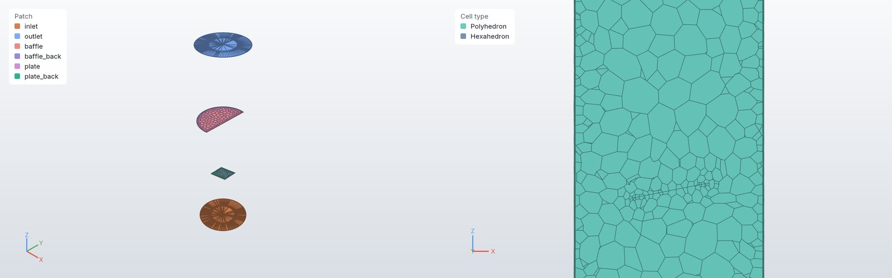

The whole agent workflow on a bare STL, one tool per step: propose the
patches (PR #62), name them and give them roles, write the FoehnCraft
boundary-condition skeleton, set up the partition, add a half baffle and
a free plate (zero-thickness shells, PR #70 and #72) and a sphere datum
of size 0.25 (`grading.add`, PR #64), then mesh. Each tool writes a new
file, so every step can be checked or undone.

```
mkdir -p out/pipe-shells && cp examples/gallery/polyhedral/pipe-shells/* out/pipe-shells/ && cd out/pipe-shells
python3 make_pipe.py pipe.stl
kofl call patch.propose --input propose.json      # opening_1, opening_2, walls
kofl call patch.rename --input name-in.json       # opening_1 -> inlet
kofl call patch.rename --input name-out.json      # opening_2 -> outlet
kofl call patch.set_role --input role-in.json
kofl call patch.set_role --input role-out.json    # -> patches.json
kofl call bc.skeleton --input skeleton.json       # -> case.toml for FoehnCraft
kofl call mesh.setup_duct --input setup.json      # -> partition.json
kofl call shell.add --input baffle.json           # -> partition-1.json
kofl call shell.add --input plate.json            # -> partition-2.json
kofl call grading.add --input probe.json          # -> partition-3.json
kofl generate-duct pipe.stl patches.json partition-3.json polyhedral mesh --handoff vtu
```

Check: 34,368 cells; the shells are the patches `baffle`/`baffle_back`
(336 faces each side, equal areas) and `plate`/`plate_back` (area equal
to the polygon, 12.24); the probe's 1,598 core cells have a median size
of 0.27 against 0.40 elsewhere (`report.json`, `grading`). `case.toml`
has `[boundary.inlet]` (`velocity-inlet`), `[boundary.outlet]`
(`static-pressure-outlet`) and `[boundary.walls]` (`wall`), each value a
TODO for FoehnCraft.
