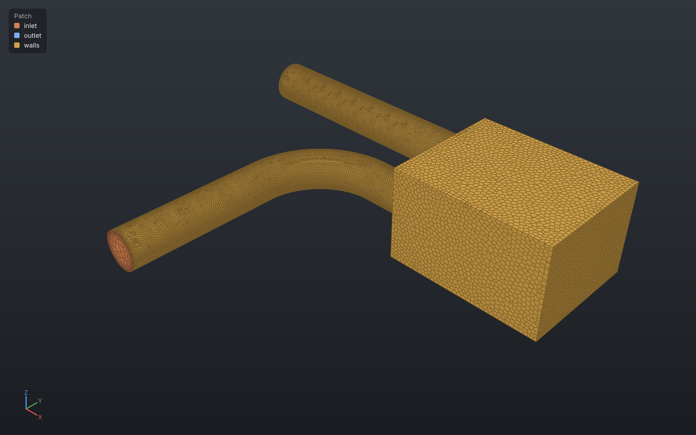
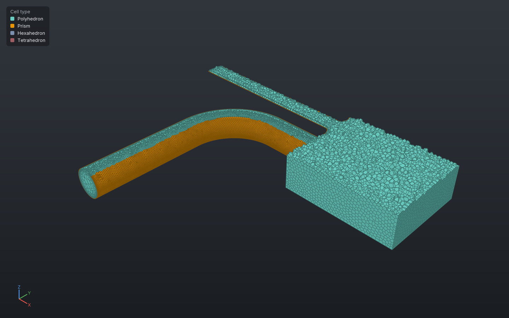
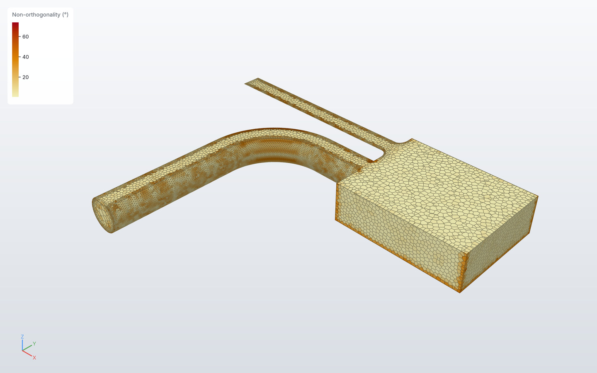

# README slideshow

Part of the [Example gallery](../gallery.md). The slides of the README's slideshow as still images. Every picture is
KoflCraft's Manifold mesh opened in [MurmelCraft](https://github.com/chiefenne/MurmelCraft)
and written by its headless `export.image` (2560 x 1600, scaled to
1440 x 900), set up by [tools/readme-tour](../../tools/readme-tour/README.md).
The mesh comes from the fixture in this repository; the command is in
[make-tour.sh](../../tools/readme-tour/make-tour.sh).

## The Manifold duct

The user-supplied Manifold STL (a pipe with a bend, a box, a rounded
junction and an outlet pipe) meshed by `generate-duct … polyhedral`:
229,615 cells with the inlet, outlet and wall patches.

## Cell types under a clip plane

Voronoi polyhedra (89,467) in the core and prism layers (140,105) at the
walls, cut by a crinkle clip that keeps whole cells.

## Cell quality

Face non-orthogonality of every cell on the cut, the check a finite-volume
solver cares about most.
